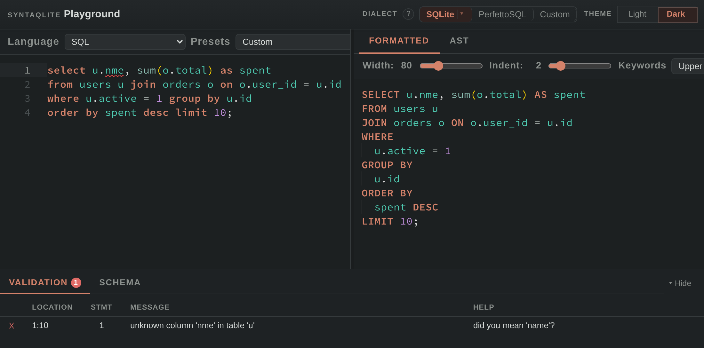

<div align="center">


<h1>syntaqlite</h1>

<p><strong>A parser, formatter, static analyzer and language server for SQLite SQL, built from SQLite's own grammar.</strong></p>

<p>
  <a href="https://crates.io/crates/syntaqlite-cli"></a>
  <a href="https://pypi.org/project/syntaqlite/"></a>
  <a href="https://www.npmjs.com/package/syntaqlite"></a>
  <a href="LICENSE"></a>
</p>

<p>
  <a href="https://playground.syntaqlite.com">Try the playground</a> ·
  <a href="#quick-start">Quick start</a> ·
  <a href="#why-syntaqlite">Why syntaqlite?</a> ·
  <a href="#install">Install</a> ·
  <a href="https://docs.syntaqlite.com/latest/">Documentation</a>
</p>

</div>

## What is syntaqlite?

syntaqlite is a formatter, static analyzer and language server for SQLite SQL,
built on a parser generated from SQLite's own grammar. Use it from the command
line, in your editor, or as a library.

- **Format SQL.** `syntaqlite fmt` formats files in place or checks them in CI.
- **Catch mistakes before you run them.** The analyzer checks queries against
  your schema without opening a database, and suggests fixes.
- **Get help in your editor.** Diagnostics, completion, hover, go to definition
  and rename in VS Code, Zed, Claude Code and other editors.
- **Match your SQLite.** It accepts and rejects the same statements as the
  SQLite version and compile-time flags you target.
- **Build your own tools.** libsyntaqlite brings the parser, formatter and
  analyzer to Rust, Python, JavaScript and C. libsyntaqlite-parser is the
  parser alone, as a C library.

## Try it in your browser

The [playground](https://playground.syntaqlite.com) runs syntaqlite in your
browser: paste SQL and a schema to see it formatted, analyzed and parsed.
Click the screenshot to open this example.

[](https://playground.syntaqlite.com/#sf=ddl&sc=MIJQogggKmAEUQEIBk4FcDOBTATh2AFAJYAmsAkgHIwDiYIsACiOQLIQgCasA0mJwBpYAOwCGAWyzwwADShCs40UQA20uUNEBjAC5EAblKq16ASgDcAKFCQY8JKlgB7HCVz5iZY2DoNmbDm4%2BQVhMXAB9UgpqH3pYcAAxejBKYDAAZVDsPE9TIR0nHVE1cAhkIS0cLFEdLBJwmvUoCyA&s=M4UwNiDGAuAECuA6AdgWxAGlseqAUA9otAdAIZgCUsZw2ADiMtAFABmATgagqB3fFgArAgEtksAhwAmIfpMkSi8PgH1R02AF4EiDSwDuACzkhdZGKIBuZnQEZYAcy7x6sAEYBPXfqmyOHt7AjMywssCQsGCiqKJwdgAMANxAA)

## Quick start

### 1. Install syntaqlite

On macOS, Linux or Windows:

```bash
curl -sSf https://raw.githubusercontent.com/LalitMaganti/syntaqlite/main/tools/syntaqlite | python3 - install
```

Prefer a package manager? See [Install](#install) for pip, Homebrew, mise and
Cargo.

### 2. Format SQL

```bash
syntaqlite fmt -e "select id,name,email from users where active=1 and role='admin' order by name"
```

```sql
SELECT id, name, email
FROM users
WHERE
  active = 1
  AND role = 'admin'
ORDER BY
  name;
```

`syntaqlite fmt -i query.sql` formats a file in place, and `--check` reports
files that aren't formatted without changing them.

### 3. Check SQL against your schema

Given this `schema.sql`:

```sql
CREATE TABLE users (id, name, email);
```

```bash
syntaqlite analyze --schema schema.sql -e "SELECT nme, email FROM users"
```

```text
error: unknown column 'nme'
 --> <expression>:1:8
  |
1 | SELECT nme, email FROM users
  |        ^~~
  = help: did you mean 'name'?
```

A `syntaqlite.toml` file maps groups of SQL files to their schemas, for both
the CLI and the language server. See
[project setup](https://docs.syntaqlite.com/latest/guides/project-setup/).

### 4. Target your SQLite version

```bash
syntaqlite --sqlite-version 3.32.0 analyze \
  -e "DELETE FROM users WHERE id = 1 RETURNING *;"
```

```text
error: syntax error near 'RETURNING'
 --> <expression>:1:32
  |
1 | DELETE FROM users WHERE id = 1 RETURNING *;
  |                                ^~~~~~~~~
```

`RETURNING` arrived in SQLite 3.35.0. Optional features work the same way,
with `--sqlite-cflag SQLITE_ENABLE_MATH_FUNCTIONS`.

## Why syntaqlite?

Most SQL tools treat SQLite as a dialect of generic SQL. That works for common
queries, but can miss syntax only SQLite has, such as `UPSERT`, `RETURNING`,
`STRICT` tables and window frames with `EXCLUDE`.

- **It parses what SQLite parses.** Across about 396,000 statements from
  [SQLite's test suite](https://sqlite.org/testing.html), it agrees with SQLite
  on 99.7%, and it parses all 40 statements of a corpus of SQLite-specific
  syntax the same way `sqlite3` does.
- **Formatting is safe.** Each of those 40 statements formats to SQL that
  SQLite compiles to the same bytecode as the original.
- **It's fast enough for every keystroke.** The parser and tokenizer are C, and
  parsing is incremental.

The [comparison](https://docs.syntaqlite.com/latest/reference/comparison/)
runs the same tests on other SQL tools, with their versions and how to
reproduce the results.

## Install

<details>
<summary>Shell installer</summary>
<p></p>

```bash
curl -sSf https://raw.githubusercontent.com/LalitMaganti/syntaqlite/main/tools/syntaqlite | python3 - install
```
</details>

<details>
<summary>pip, Homebrew, mise or Cargo</summary>
<p></p>

```bash
pip install syntaqlite
brew install LalitMaganti/tap/syntaqlite
mise use github:LalitMaganti/syntaqlite
cargo binstall syntaqlite-cli   # downloads the prebuilt binary
cargo install syntaqlite-cli    # builds from source
```
</details>

<details>
<summary>Editors</summary>
<p></p>

- **VS Code:** install
  [syntaqlite](https://marketplace.visualstudio.com/items?itemName=syntaqlite.syntaqlite)
  from the Marketplace.
- **Zed:** follow the [Zed guide](https://docs.syntaqlite.com/latest/getting-started/zed/).
- **Claude Code:** `claude plugin install syntaqlite@lalitmaganti-plugins`.
- **Other editors:** start `syntaqlite lsp` from your LSP client. The
  [editor guide](https://docs.syntaqlite.com/latest/getting-started/other-editors/) has examples.
</details>

<details>
<summary>Libraries</summary>
<p></p>

```bash
cargo add syntaqlite        # Rust
pip install syntaqlite      # Python
npm install syntaqlite      # JavaScript and WebAssembly
```

For C, download libsyntaqlite or libsyntaqlite-parser from the
[latest release](https://github.com/LalitMaganti/syntaqlite/releases/latest),
or build libsyntaqlite with `cargo build -p syntaqlite-capi`. The
[C guide](https://docs.syntaqlite.com/latest/getting-started/c/) explains which to choose.
</details>

## Documentation

- Getting started:
  [CLI](https://docs.syntaqlite.com/latest/getting-started/cli/),
  [VS Code](https://docs.syntaqlite.com/latest/getting-started/vscode/),
  [Zed](https://docs.syntaqlite.com/latest/getting-started/zed/),
  [other editors](https://docs.syntaqlite.com/latest/getting-started/other-editors/),
  [Rust](https://docs.syntaqlite.com/latest/getting-started/rust/),
  [Python](https://docs.syntaqlite.com/latest/getting-started/python/),
  [JavaScript](https://docs.syntaqlite.com/latest/getting-started/javascript/) and
  [C](https://docs.syntaqlite.com/latest/getting-started/c/).
- Guides:
  [project setup](https://docs.syntaqlite.com/latest/guides/project-setup/),
  [CI integration](https://docs.syntaqlite.com/latest/guides/ci-integration/) and
  [custom dialects](https://docs.syntaqlite.com/latest/guides/custom-dialects/).
- Reference:
  [CLI](https://docs.syntaqlite.com/latest/reference/cli/),
  [configuration file](https://docs.syntaqlite.com/latest/reference/config-file/),
  [formatting options](https://docs.syntaqlite.com/latest/reference/formatting-options/) and
  [language server features](https://docs.syntaqlite.com/latest/reference/lsp-features/).

## Project status

syntaqlite is usable today but still 0.x: its APIs and command-line interface
may change before 1.0.

## Contributing

```bash
tools/install-build-deps
tools/cargo build
```

The [contributing guide](https://docs.syntaqlite.com/latest/contributing/) covers the repository layout and
tests. Pull requests are welcome.

## AI usage

For coding: AI was used extensively for mechanical implementation, but the design,
architecture, and overall shape of the project came from me. I understand all of the code
and take full responsibility for it.

For other tasks: AI was used for research, brainstorming, testing, documentation, and
integrations. I wrote a
[detailed account of how I built syntaqlite with AI](https://lalitm.com/post/building-syntaqlite-ai/),
including where it helped and where it was detrimental.

## License

Apache 2.0. The parts derived from SQLite are public domain under the
[SQLite blessing](https://www.sqlite.org/copyright.html). See [LICENSE](LICENSE) for details.
